# 企业大模型安全脱敏网关 · 60fps 产品宣传片与交互式演示工程

> **「十几毫秒全自动无感闭环 · 让 AI 看懂问题，但看不见秘密。」**
>
> 本仓库完整收录 **企业大模型安全脱敏网关**（硬件简称 **「脱敏网关」**）39 秒 **60fps** 双端宣传片成品（`16:9` 横屏 & `9:16` 竖屏）、零依赖交互式原理演示网页、全过程 21 轮设计思路与视觉演进细节、纯时间确定性渲染母版源码，以及 **像素级零抖动（`diffPx = 0, maxDelta = 0`）** 抽帧与 VideoToolbox 硬件编码工具链。

---

## 一、成品直接预览与下载（`成品交付/`）

| 交付产物 | 规格参数 | 适用场景 |
| --- | --- | --- |
| [**企业大模型安全脱敏网关_宣传片_横屏16x9.mp4**](./成品交付/企业大模型安全脱敏网关_宣传片_横屏16x9.mp4) | `1920×1080` · **60fps** · H.264 无 B 帧高码率 · `0:39.0`（`15 MB`） | 售前 PPT 嵌入、官网首屏、展厅大屏、电脑全屏演示 |
| [**企业大模型安全脱敏网关_宣传片_竖屏9x16.mp4**](./成品交付/企业大模型安全脱敏网关_宣传片_竖屏9x16.mp4) | `1080×1920` · **60fps** · H.264 无 B 帧高码率 · `0:39.0`（`14 MB`） | **微信私聊原画直发（< 25 MB 零压缩）**、视频号、手机全屏点开即看 |
| [**企业大模型安全脱敏网关_原理演示.html**](./成品交付/企业大模型安全脱敏网关_原理演示.html) | 单文件零依赖交互式 HTML（支持 4 大行业场景切换与分步拆解） | 现场技术交流、架构师手控讲解、离线客户演示 |

---

## 二、核心设计思路与视觉架构亮点

详细设计推导请参阅 👉 **[`docs/01-设计思路与视觉架构详解.md`](./docs/01-设计思路与视觉架构详解.md)**

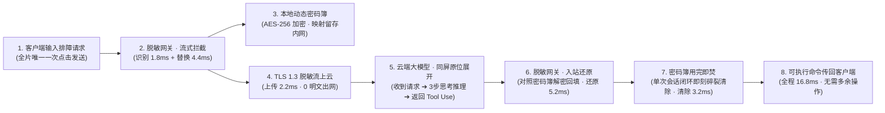

### 1. 解决「毫秒级全自动无感拦截 vs. 观众肉眼看清加密替换逻辑」的矛盾
- **全片仅一次初始点击**：只在 `00:02.3` 用户发送排障请求时出现唯一一次鼠标点击，随后由顶栏毫秒级 HUD 计时器（`0.2 ms ➔ 6.2 ms ➔ 8.4 ms ➔ 16.8 ms`）接管，配合关键帧慢放拆解，避免给客户造成「需要多次手动点击操作」的误解。
- **一镜到底单容器连续形变（对标 Prompt Motion `twoclipping-5cba86`）**：摒弃传统多页面淡入淡出造成的视线断裂，中央卡片 `#mainCard`、物理硬件 `#gwUnit`（**脱敏网关**）与本地动态密码簿 `#vaultBox` 通过有限时长五次 $C^2$ 无过冲曲线连续协同。

### 2. 四色凭据语义闭环 + 双段式无遮挡贝塞尔曲线路径
- **四色语义**：**珊瑚红**（原始敏感明文：`db_fin_admin` / `Kp9#mX2v` / `10.28.104.56:5432`）➔ **加密紫**（本地 `AES-256` 密文指纹）➔ **海洋蓝**（发往云端的语义一致脱敏代号：`{{USER_8d4e}}` / `{{PWD_5a1f}}` / `{{HOST_3b9c}}`）➔ **翡翠绿**（入站查表还原的真实可执行凭据）。
- **双段式网关中转路径**：上方 3 条三次贝塞尔曲线从原文固定宽槽位汇聚至中央**脱敏网关**顶部端口，再由网关底部垂直主干注入下方密码簿，彻底杜绝曲线穿越密码簿标题栏造成的遮挡。

### 3. 本地动态密码簿（`#vaultBox`）的四阶段视觉重心缩放生命周期
1. **出站建立映射（`1.00x` 居中下方）**：清晰展示三行三列「明文 ➔ AES 密文 ➔ 脱敏代号」实时写入；
2. **云端推理期驻留左上角（`0.35x` 缩小驻留）**：将视觉重心让给云端推理，同时以左上角 `本地密码簿 · 内网隔离待命 (3 项)` 强化「映射锁死内网、绝不出网」的空间锚点；
3. **入站查表解密（`1.00x` 回归工作区）**：云端返回 `Tool Use` 命令后放大归位，完成代号比对与绿色真凭据回填；
4. **舞台中央聚光与用完即焚（`1.14x` 居中放大 + 60fps 字符碎裂）**：单次会话闭环后移至画面中央，三行映射逐字爆散碎裂（`.sh-char` + `.sh-chip` 物理粒子），折叠落定 `✓ 本次会话 3 项映射已彻底销毁 · 内存零残留` 封条。

### 4. 同屏「左内网守卫 + 右云端顶部整数锚定三阶展开」
- 取消独立云端切页，在保持左侧密码簿与**脱敏网关**不动的同屏画面中，右侧深色云端终端锁死左上角整数坐标（横屏 `(876, 310)` / 竖屏 `(65, 672)`），顶部纹丝不动、仅底部平滑向下分三阶展开：
  - **阶段一**：收到网关请求（仅含蓝色脱敏代号）；
  - **阶段二**：展开 `01 识别配置隐患` ➔ `02 规划排障路径` ➔ `03 构造工具调用` 三步思考推理过程（Chain of Thought）；
  - **阶段三**：继续向下展开诊断结论与两条 `psql` `Tool Use` 命令，并沿绿色反向链路发回左侧**脱敏网关**。

---

## 三、全套高清分镜预览（`16:9` 横屏 & `9:16` 竖屏）

| 01 · 客户端顺序输入（零预留空白乱码） | 02 · 识别三处敏感凭据并双段提取入网关 |
| :---: | :---: |
| 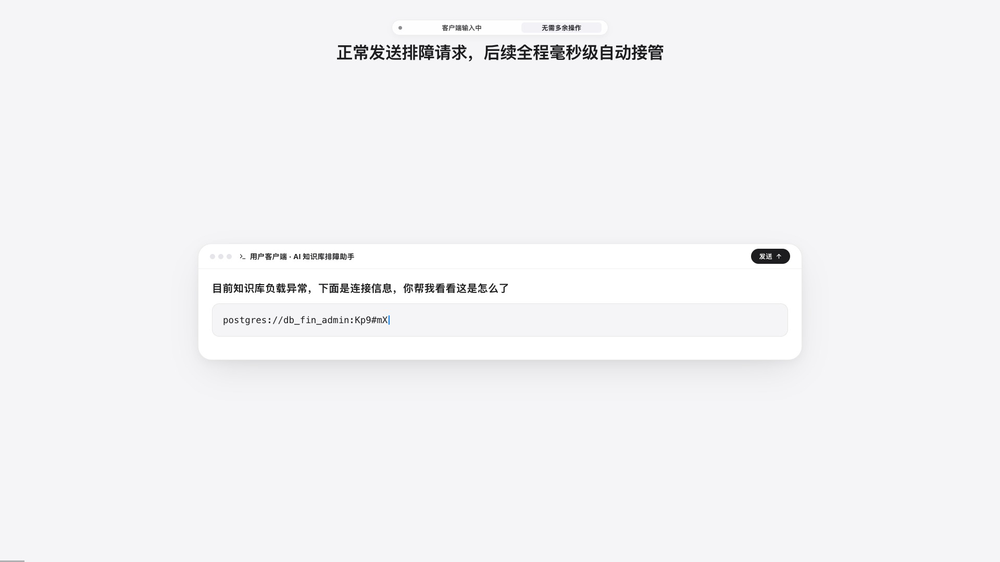 | 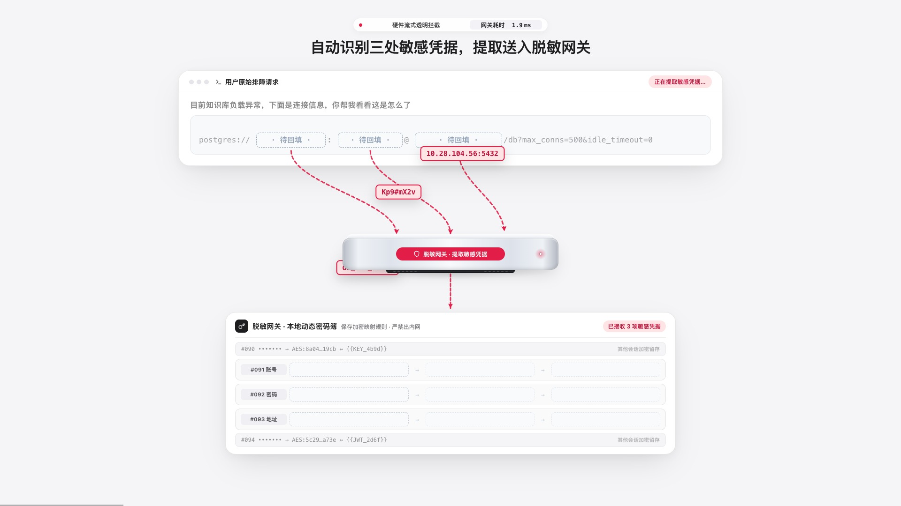 |
| **03 · 密码簿 AES-256 加密与蓝色代号回填** | **04 · 密码簿驻留左上角 · 脱敏流发往云端** |
| 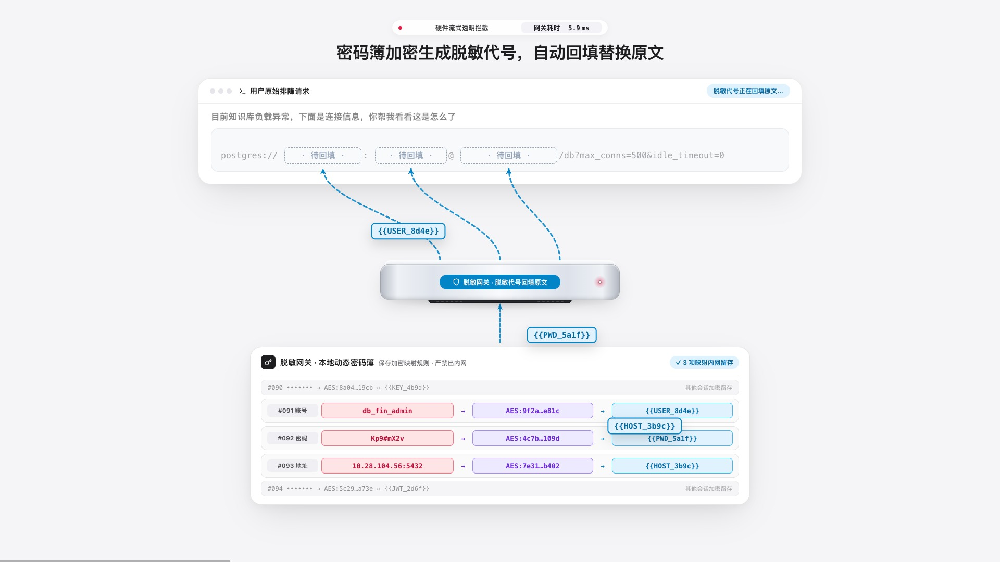 | 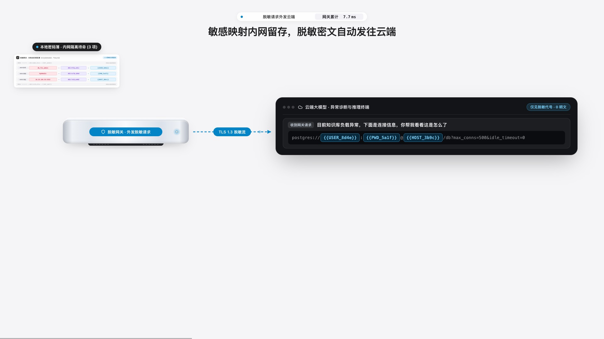 |
| **05 · 云端零明文 3 步深度思考推理** | **06 · 同卡向下展开 Tool Use 命令并回传网关** |
| 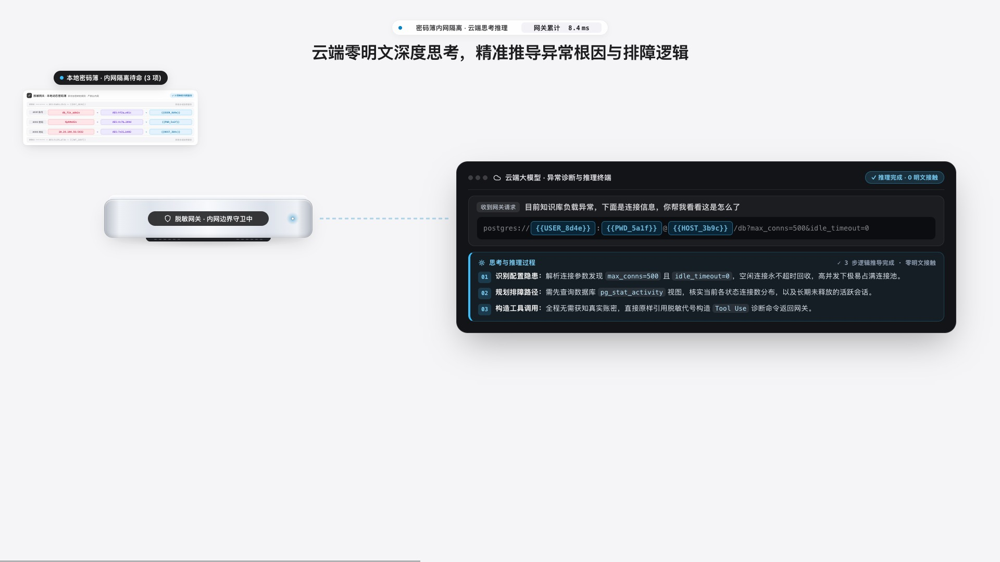 | 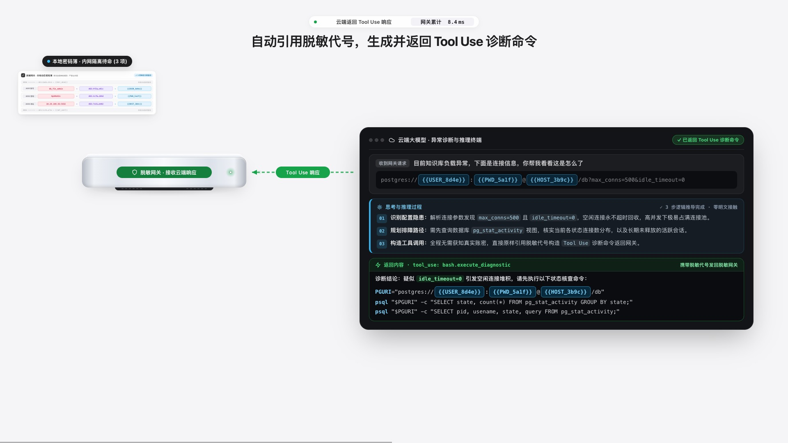 |
| **07 · 网关对照密码簿解密还原真实凭据** | **08 · 用完即焚：密码簿居中聚光与字符碎裂** |
| 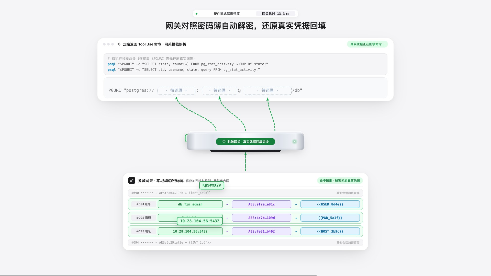 | 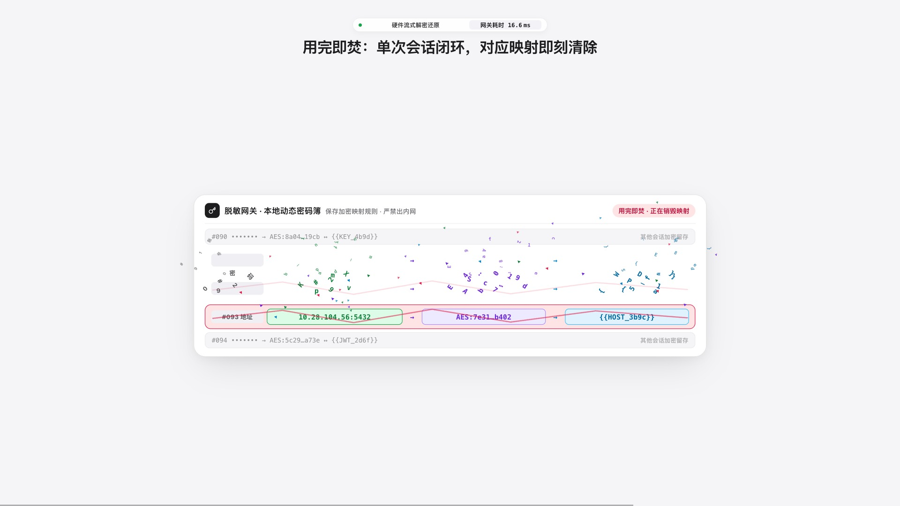 |
| **09 · 可执行排障命令无感传回客户端** | **10 · 16.8 ms 五步耗时与三大价值看板** |
| 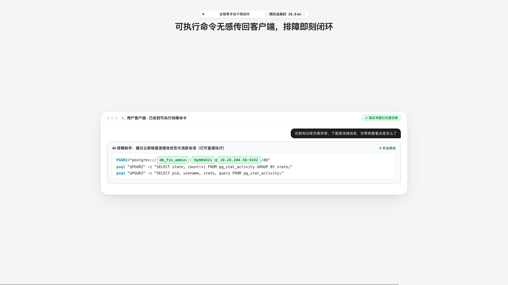 | 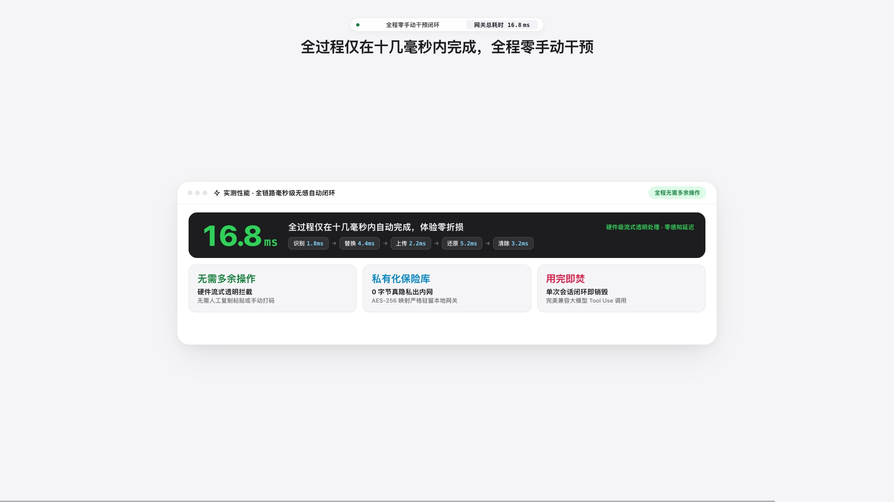 |

### 9:16 微信竖屏全屏版（`< 25 MB` 微信原画直发）

| 出站识别提取（`9:16`） | 云端思考与返回 Tool Use（`9:16`） | 用完即焚字符碎裂（`9:16`） |
| :---: | :---: | :---: |
| 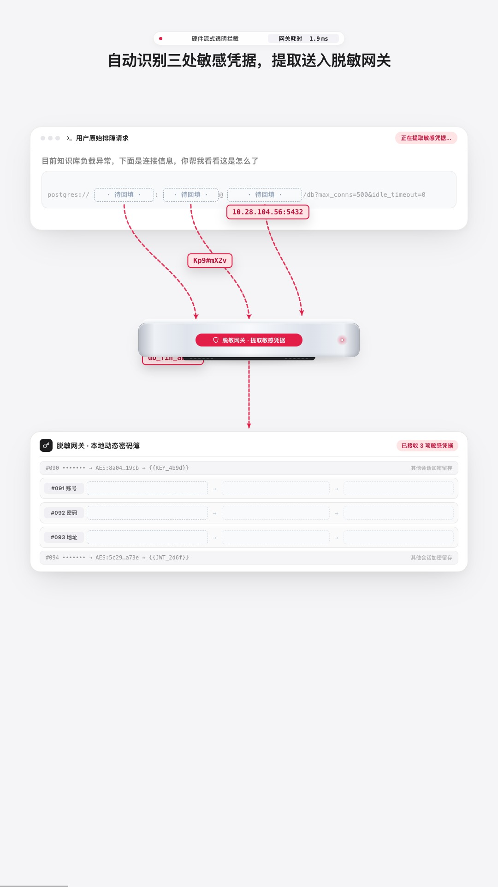 | 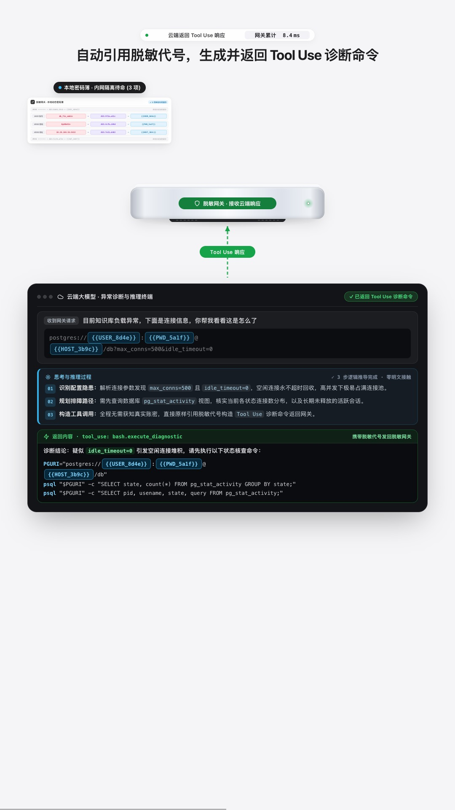 | 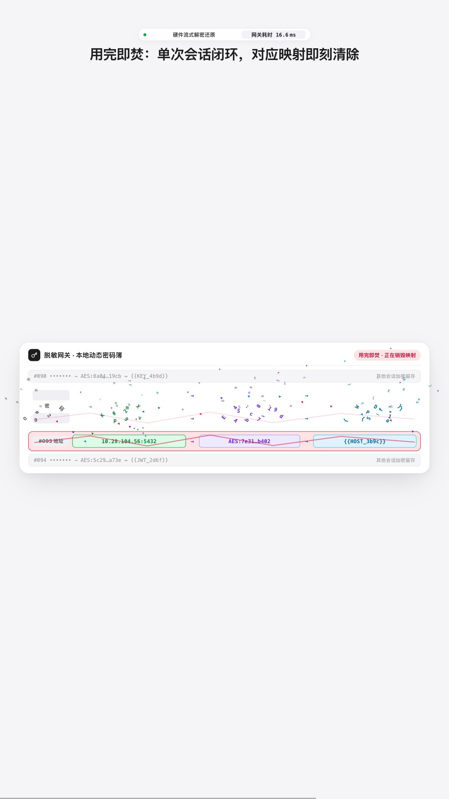 |

---

## 四、60fps 像素级零抖动工程复盘（`diffPx = 0, maxDelta = 0`）

详细技术排查与数学证明请参阅 👉 **[`docs/02-60fps零抖动渲染与编码工程复盘.md`](./docs/02-60fps零抖动渲染与编码工程复盘.md)**

在 `v10 ➔ v11` 终极打磨中，我们编写了原生 Swift 逐像素帧间差分审计器（[`源码与重制工具/full_video_jitter_audit.swift`](./源码与重制工具/full_video_jitter_audit.swift)），排查并彻底根治了三处隐藏在浏览器合成器与 H.264 编码器底层的抖动源：

1. **根除 Chromium `will-change` GPU 瓦片亚像素相位缓存 + 6 路并发 Worker 轮询交错导致的 60Hz 全屏震颤**
   - 移除全部 `will-change`、`backface-visibility`、`translate3d` 与 CSS `filter`，统一采用整数像素 `left/top/width/height` + 稳态 `transform: none`；
   - 将 [`film_capture.cjs`](./源码与重制工具/film_capture.cjs) 并发 Worker 从轮询领帧（`0, 1, 2, 3, 4, 5` 交错）改为按连续帧块（`390` 帧/段）顺序渲染，单帧静止像素差异从 `61,733 px (maxDelta = 217)` 彻底归零为 **`0 px (maxDelta = 0)`**。
2. **有限时长五次 $C^2$ 曲线 + 顶栏等宽右对齐毫秒槽位 + 整数边框**
   - 将渐近指数弹簧替换为有限时长五次多项式 `springStep`，彻底消除运动尾段约 20 帧的亚像素蠕动；将顶栏毫秒数独立为 `38px` 定宽右对齐容器 `#msNum`，消除 `9.9 -> 10.0 ms` 进位时的左右横跳。
3. **禁用 VideoToolbox H.264 B 帧重排（消除关键帧与 B/P 帧量化呼吸）**
   - 在 [`capture_encode.swift`](./源码与重制工具/capture_encode.swift) 中设置 `AVVideoAllowFrameReorderingKey: false` 并提升目标码率至 `8.5~9.0 Mbps`。由于静止帧现已 `100%` 逐比特一致，编码器直接生成零残差 `P_SKIP` 宏块，成片体积反而从 `18 MB` 降至 `15 MB / 14 MB`，且对最终 `.mp4` 逐帧解码校验达到 **`frozenJitterFrames = 0, maxFrozenDelta = 0`**。

---

## 五、仓库目录结构

```text
video-prom/
├── README.md                                      # 仓库总览、设计思路提要、预览画廊与复现指南
├── 成品交付/                                       # 最终交付成品（可直接用于演示与投放）
│   ├── 企业大模型安全脱敏网关_宣传片_横屏16x9.mp4      # 1920×1080 60fps 横屏成片 (15 MB)
│   ├── 企业大模型安全脱敏网关_宣传片_竖屏9x16.mp4      # 1080×1920 60fps 微信竖屏成片 (14 MB)
│   └── 企业大模型安全脱敏网关_原理演示.html            # 零依赖单文件交互式原理演示网页
├── docs/                                          # 设计思路、工程复盘与 21 轮完整迭代文档库
│   ├── 01-设计思路与视觉架构详解.md                  # 叙事架构、四色语义、双段曲线、密码簿生命周期详解
│   ├── 02-60fps零抖动渲染与编码工程复盘.md            # 60Hz 亚像素瓦片震颤与 H.264 B 帧量化呼吸破案实录
│   ├── 03-21轮完整迭代演进记录.md                    # 会话全过程 21 轮需求演进与上下文归档
│   ├── 04-脱敏网关演示交付与使用指南.md              # 39 秒分镜表与客户演示指南
│   └── 05-早期形体变换重制方案_v5.md                 # 早期 Prompt Motion 形体变换设计方案归档
└── 源码与重制工具/                                  # 宣传片母版源码、60fps 抽帧器、编码器与审计工具
    ├── film.html                                  # v11 像素级零抖动 60fps 确定性动画母版
    ├── film_capture.cjs                           # Playwright 连续分块并发 60fps 抽帧与关键帧截屏脚本
    ├── capture_encode.swift                       # macOS VideoToolbox 无 B 帧高码率 H.264 编码器源码
    ├── capture_encode                             # 编译好的原生编码器二进制
    ├── qa_video.swift                             # 视频轨道、帧率、时长与抽帧校验工具源码
    ├── qa_video                                   # 编译好的视频校验二进制
    ├── full_video_jitter_audit.swift              # 2,340 帧渲染图与 MP4 解码帧逐像素零抖动审计工具
    ├── 关键帧预览_16x9/                             # 16:9 横屏 18 张关键帧高清预览图
    └── 关键帧预览_9x16/                             # 9:16 竖屏 18 张关键帧高清预览图
```

---

## 六、快速预览与一键重出 60fps 视频指南

### 1. 浏览器实时 60fps 预览母版
直接在 Chrome 中打开 `源码与重制工具/film.html`：
- **横屏 `16:9` 自动循环播放**：`film.html?ar=16x9&play=1`
- **竖屏 `9:16` 自动循环播放**：`film.html?ar=9x16&play=1`
- **精准定位至任意秒数（如 `16.40s`）**：`film.html?ar=16x9&t=16.40`
- **自定义片尾品牌名称**：`film.html?ar=16x9&play=1&brand=自定义网关名称`

### 2. 一键重新渲染并编码导出 1080p 60fps 零抖动 MP4

```bash
cd 源码与重制工具

# 1. 渲染并编码 16:9 横屏版 (2340 帧 @ 60fps)
node film_capture.cjs --frames 16x9 ./frames_16x9 60 6
rm -f ../成品交付/企业大模型安全脱敏网关_宣传片_横屏16x9.mp4
./capture_encode ./frames_16x9 60 ../成品交付/企业大模型安全脱敏网关_宣传片_横屏16x9.mp4 9000000

# 2. 渲染并编码 9:16 竖屏版 (2340 帧 @ 60fps)
node film_capture.cjs --frames 9x16 ./frames_9x16 60 6
rm -f ../成品交付/企业大模型安全脱敏网关_宣传片_竖屏9x16.mp4
./capture_encode ./frames_9x16 60 ../成品交付/企业大模型安全脱敏网关_宣传片_竖屏9x16.mp4 8500000

# 3. 运行像素级零抖动审计校验
swiftc -O full_video_jitter_audit.swift -o audit_bin
./audit_bin mp4 ../成品交付/企业大模型安全脱敏网关_宣传片_横屏16x9.mp4
./audit_bin mp4 ../成品交付/企业大模型安全脱敏网关_宣传片_竖屏9x16.mp4
```
