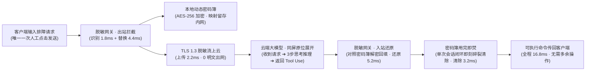
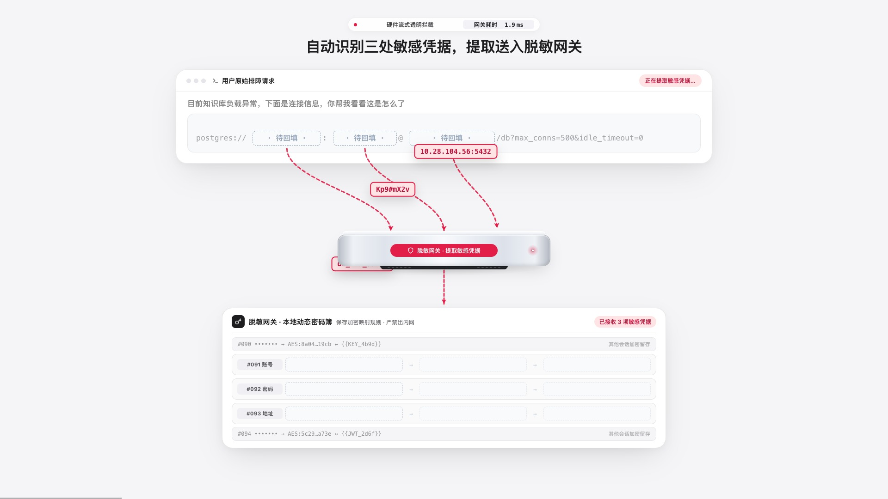
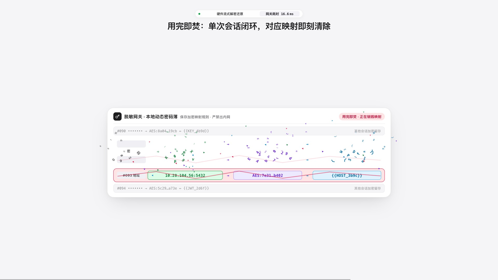
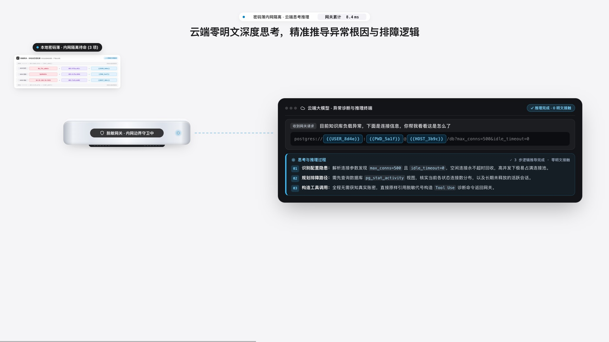
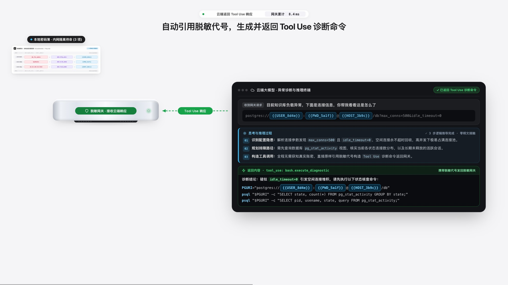
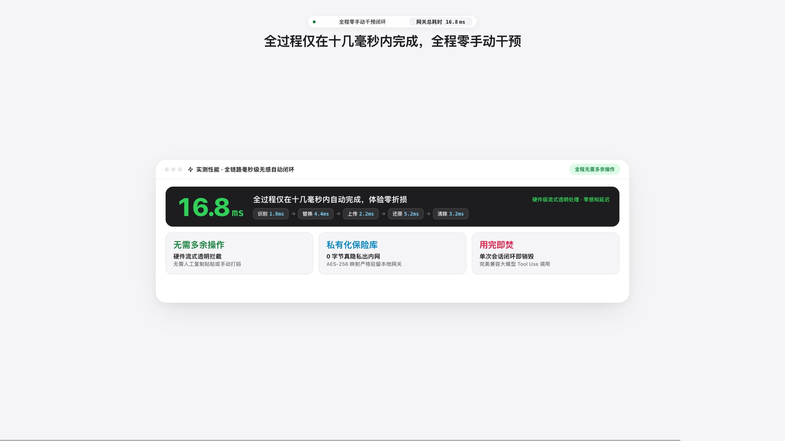

# 企业大模型安全脱敏网关 · 宣传片设计思路与视觉架构详解

本文档系统梳理 **「企业大模型安全脱敏网关」**（硬件简称 **「脱敏网关」**）39 秒 60fps 产品宣传片的核心设计哲学、叙事逻辑、视觉重心编排、色彩语义体系与工业设计规范。

---

## 一、核心设计命题：如何让「几毫秒内全自动完成的底层安全拦截」被观众一眼看懂？

在企业大模型落地的真实场景中，研发或运维人员向 AI 发送排障请求（包含数据库账密、内网 IP 端口等高敏凭据）并接收 `Tool Use` 诊断命令时，**脱敏网关**的全部拦截、加密、替换、还原与销毁动作均在 **十几毫秒（`16.8 ms`）内以流式硬件管线全自动完成**，用户侧除了最初点击一次「发送」外，**全程零手动干预**。

这带来了一个典型的视觉传达矛盾：
1. **如果按真实毫秒级速度一闪而过**：观众根本看不清「哪里被替换了」「密码簿怎么映射的」「云端到底看到了什么」「返回命令怎么还原的」；
2. **如果做成传统多页面切换或多次鼠标点击**：不仅画面割裂、视线频繁丢失，还会给客户造成「每次脱敏和还原都需要人工点一下」的严重误导。

### 破局方案：「全自动毫秒级 HUD 计时 + 关键帧慢放拆解 + 一镜到底单容器连续形变」

- **仅保留唯一一次初始点击**：全片只在 `00:02.3` 用户发送提问时出现一次鼠标点击，随后光标立即离场，顶部 HUD 胶囊实时跳动硬件管线耗时（`0.2 ms ➔ 6.2 ms ➔ 8.4 ms ➔ 16.8 ms`），明确传达「硬件流式透明拦截 · 慢放拆解」。
- **借鉴 Prompt Motion（`twoclipping-5cba86`）的一镜到底容器形变**：
  - 摒弃传统 PPT 式的整页淡入淡出，全片围绕中央主容器 `#mainCard`、物理硬件 `#gwUnit`（**脱敏网关**）与本地动态密码簿 `#vaultBox` 三个核心实体的空间协同展开。
  - 容器的位置、宽高与圆角通过无过冲平滑曲线连续过渡，让观众的视线始终锚定在同一个视觉焦点上。

---

## 二、五大核心视觉机制设计

### 1. 四色凭据语义体系（Four-Color Credential Semantics）

为了让观众在慢放拆解中一眼看清三处敏感字段（`db_fin_admin`、`Kp9#mX2v`、`10.28.104.56:5432`）的来龙去脉，全片建立了严格闭环的四色编码规则：

| 阶段 | 颜色语义 | 色值（背景 / 描边 / 文字） | 视觉含义 |
| --- | --- | --- | --- |
| **① 识别与提取明文** | **珊瑚红（Coral Red）** | `#ffe4e6` / `#e11d48` / `#be123c` | 原始请求中暴露的高危敏感凭据（账号、密码、内网地址），禁止直接出网 |
| **② 本地加密落库** | **加密紫（Cipher Violet）** | `#ede9fe` / `#a78bfa` / `#6d28d9` | 在本地密码簿内经 `AES-256-GCM` 硬件加密生成的密文指纹（`AES:9f2a…e81c` 等） |
| **③ 脱敏代号替换与上云** | **海洋蓝（Ocean Blue）** | `#e0f2fe` / `#0284c7` / `#0369a1` | 可安全发往云端大模型的语义一致占位符（`{{USER_8d4e}}`、`{{PWD_5a1f}}`、`{{HOST_3b9c}}`） |
| **④ 解密还原与回填** | **翡翠绿（Emerald Green）** | `#dcfce7` / `#16a34a` / `#15803d` | 云端返回 `Tool Use` 命令后，经网关对照密码簿无感还原回填的真实可执行凭据 |

### 2. 双段式无遮挡曲线箭头与飞行胶囊（Two-Segment Gateway Routing）

在早期版本中，若直接从上方原文卡片拉一条长曲线跨越中间的**脱敏网关**连向底部密码簿，虚线会穿过密码簿深色标题栏，造成文字遮挡与视觉杂乱。

最终方案采用 **「双段式经由脱敏网关中转」** 的物理拓扑路径：
1. **上段分支（3 条精确 De Casteljau 三次贝塞尔曲线）**：从原文的 `① 账号`、`② 密码`、`③ 地址` 三个固定槽位底部出发，分别汇聚接入中央 **脱敏网关** 顶部的左、中、右三个流式处理端口（`gwPortX = gwSpec[0] + (i - 1) * 115`）；
2. **下段总线（垂直主干虚线箭头）**：从 **脱敏网关** 底部正中垂直注入下方 **本地动态密码簿** 顶部边界（留出 `8px` 呼吸间距，绝不压盖标题栏）；
3. **实体飞行胶囊（`#fly0 ~ #fly2`）**：三枚高对比度彩色胶囊按 `0.14s` 错峰时序沿贝塞尔轨迹穿过**脱敏网关**，直观展现「明文吸入网关 ➔ 密文写入密码簿 ➔ 蓝色代号飞回原文槽位」以及返程「蓝色代号送入查表 ➔ 绿色真凭据飞回命令槽位」的完整对应关系。

### 3. 本地动态密码簿（`#vaultBox`）的四阶段视觉重心生命周期

密码簿是建立「加密映射可解释性」的核心道具，但它在不同叙事阶段的视觉权重截然不同。为此设计了 **四阶段动态缩放生命周期**：

1. **阶段 A · 出站映射建立（`00:03.0 – 00:11.1`，缩放比 `1.00x`，居中下方）**
   - 完整展示 `#091 账号`、`#092 密码`、`#093 地址` 三行三列对照表（`敏感明文 ➔ AES-256 密文 ➔ 脱敏代号`），上下保留 `#090`、`#094` 两条静态灰显背景会话，体现多会话并发能力。
2. **阶段 B · 云端推理期间驻留左上角（`00:11.2 – 00:21.5`，缩放比 `0.35x / 0.36x`，左上角内网隔离区）**
   - 当脱敏请求发往云端时，视觉重心让位给右侧的云端推理终端；密码簿平滑缩小并驻留在画面左上角，上方亮起深色角标 **`本地密码簿 · 内网隔离待命 (3 项)`**，时刻提醒观众「真实账密始终锁在内网，从未出网」。
3. **阶段 C · 入站查表解密（`00:21.6 – 00:26.3`，缩放比 `1.00x`，回归中央下方）**
   - 云端返回 `Tool Use` 命令后，密码簿从左上角重新放大回到工作区，与中央**脱敏网关**配合完成三处代号的比对解锁（红框转为绿框）并向上回填真实凭据。
4. **阶段 D · 舞台中央聚光与用完即焚碎裂（`00:26.4 – 00:29.5`，缩放比 `1.14x / 1.04x`，画面正中聚光）**
   - 单次排障会话闭环后，上方卡片淡出，密码簿移至画面正中央并放大至 `1.14x` 成为唯一视觉焦点；
   - `#091`、`#092`、`#093` 三行依次闪现珊瑚红清除预警与裂纹线，随后行内每个字符（`.sh-char`）与几何碎片（`.sh-chip`）在确定性物理速度场与重力加速度（`grav = 155 * dt²`）驱动下向外爆散消融；
   - 活动区平滑收拢折叠，落定翠绿色安全封条：**`✓ 本次会话 3 项映射已彻底销毁 · 内存零残留`**。

### 4. 同屏「左内网守卫 + 右云端顶部锚定三阶展开」架构（Scene 3）

在展示云端大模型处理时，如果单独切出一个全屏页面，观众会失去「内网与云端物理隔离」的空间参照；如果云端卡片在追加内容时垂直居中重排，卡片上下边缘会反复跳动两次，导致阅读视线中断。

因此，云端阶段采用 **同屏左右（竖屏为上下）分治 + 顶部整数像素刚性锚定** 设计：
- **左侧内网防线恒定不动**：左上角驻留缩小的本地密码簿，左中驻留物理**脱敏网关**（状态胶囊显示 `脱敏网关 · 内网边界守卫中`）；
- **右侧云端终端左上角锁死整数坐标**（横屏 `(876, 310)`，竖屏 `(65, 672)`），卡片高度分三阶段丝滑向下延展，**顶部标题栏与已出现的文字纹丝不动**：
  1. **第一阶（`11.4s – 13.4s`，高度 `H1`）**：接收网关经 `TLS 1.3 脱敏流` 发来的脱敏请求，蓝色高亮展示三处占位符；
  2. **第二阶（`13.5s – 17.5s`，高度延展至 `H2`）**：向下展开蓝色左边框的 **「思考与推理过程（Chain of Thought）」**，纯透明度依次浮现 `01 识别配置隐患`（`max_conns=500` 且 `idle_timeout=0`）➔ `02 规划排障路径`（查询 `pg_stat_activity`）➔ `03 构造工具调用`（无需真实账密，直接引用脱敏代号）；
  3. **第三阶（`17.6s – 21.5s`，高度延展至 `H3`）**：继续向下展开绿色左边框的 **「返回内容 · `tool_use: bash.execute_diagnostic`」**（诊断结论 + 两条携带占位符的 `psql` 诊断命令），同时由右向左亮起绿色反向脉冲链路 `← Tool Use 响应` 发回左侧**脱敏网关**。

| 阶段二：云端 3 步思考与推理过程 | 阶段三：同卡继续向下展开返回 Tool Use 命令 |
| :---: | :---: |
|  |  |

### 5. Apple 工业设计硬件与克制商业文案铁律

1. **物理硬件形态（Apple Mac mini 级一体成型阳极氧化铝机身）**
   - 命名严格统一为 **「脱敏网关」**；
   - 机身采用多层线性高光梯度模拟阳极氧化银铝倒角与顶盖高光，正面**无任何品牌 Logo、无杂乱网口或按键**，仅右侧保留一枚带双层呼吸光晕的微孔状态指示灯（随阶段切换珊瑚红 / 海洋蓝 / 翡翠绿），底部为内缩式哑光黑散热格栅底座。
2. **画面文案「Show, Don't Meta-Narrate」克制铁律**
   - 严禁在画面标题或状态胶囊中出现「红色明文」「蓝色代号」「绿色真凭据」「箭头提取」「密码簿缩小驻留左上角」「文字碎裂」等解释动画技法本身的分镜词；
   - 视觉技法（四色、曲线箭头、缩放、碎裂）只由画面直接呈现，文字只承载纯粹的企业安全与业务语义。
3. **高潮性能看板与品牌收束（Scene 6）**
   - 以超大号等宽数字定格 **`16.8 ms`**，下方清晰列出五步硬件流式耗时拆解：**`识别 1.8ms` → `替换 4.4ms` → `上传 2.2ms` → `还原 5.2ms` → `清除 3.2ms`**；
   - 凝练三大核心产品价值支柱：**`无需多余操作`** · **`私有化保险库`** · **`用完即焚`**，最终收束于一体成型**脱敏网关**硬件与品牌 Slogan：**「十几毫秒全自动无感闭环 · 让 AI 看懂问题，但看不见秘密。」**

| 16.8 ms 极速性能看板 | 品牌收束定版 |
| :---: | :---: |
|  |  |
