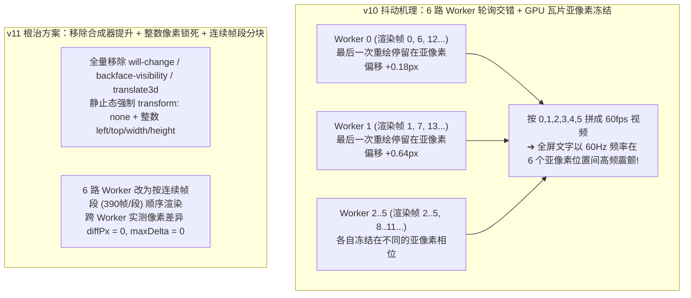

# 60fps 确定性渲染架构与像素级零抖动工程复盘

本文档记录 **「企业大模型安全脱敏网关」** 宣传片从浏览器 DOM/SVG 渲染到 macOS VideoToolbox 硬件编码的完整技术实现，重点复盘 `v10 ➔ v11` 阶段如何通过逐像素帧间差分工具定位并彻底根除 **60Hz 高频微颤**。

---

## 一、纯时间函数驱动的 60fps 确定性渲染架构

为了让复杂的 UI 动效、贝塞尔曲线生长与粒子碎裂在导出 `1920×1080`（横屏）和 `1080×1920`（竖屏）60fps 视频时达到 **100% 帧级可复现**，全片 (`源码与重制工具/film.html`) 摒弃了 `CSS Transitions`、`CSS Keyframes` 与 `setInterval` 状态累加器，采用 **纯时间确定性渲染函数 `seek(t)`（即 `window.__renderAt(t)`）**：

$$\text{Frame}(k) = \text{seek}\!\left(\frac{k}{60}\right), \quad k \in [0, 2339]$$

1. **任意时间点无状态随机访问**：无论按顺序播放还是任意乱序跳转到时间戳 $t$，页面上每一个 DOM 节点的坐标、尺寸、透明度、SVG 路径与碎裂粒子位置均由 $t$ 的闭式数学函数唯一决定。
2. **启动即一次性测量静态几何锚点 (`measureOnce()`)**：
   - 在 `document.fonts.ready` 完成后，脚本先将 `#mainCard`、`#v1 ~ #v6`、`#vaultBox`、`#cloudOutCard` 置为标准 1:1 测量态，通过 `getBoundingClientRect()` 一次性读取发送按钮、三处加密凭据槽位、三处解密槽位以及密码簿全部单元格的精确像素坐标并缓存至 `M`。
   - 在 `seek(t)` 循环中**只写样式、不读布局**（并在样式缓存器 `S(el, prop, v)` 中跳过未变化属性），彻底避免 Layout Thrashing。
3. **自适应双画幅坐标系统 (`16:9` & `9:16`)**：
   - 通过 URL 参数 `?ar=16x9` 或 `?ar=9x16` 切换横竖屏布局表 `L`，同一套母版代码同时生成电脑大屏版（`1920×1080`）与微信竖屏全屏版（`1080×1920`）。

---

## 二、`v10 ➔ v11` 像素级去抖动破案全记录

### 1. 问题现象：为什么 DOM 坐标显示 `0.000 px` 偏移，肉眼看视频却仍有高频抖动？

在 `v10` 版本中，我们已经移除了全局镜头缩放、将卡片改为无过冲曲线并锁定了容器宽度。在单个浏览器标签页内用脚本连续采样 500 帧的 `getBoundingClientRect()`，所有静止元素的坐标偏移均为 `0.000 px`。

然而播放导出的 `v10` 视频时，在 `00:01`（顶栏）、`00:05`（顶栏与请求卡）、`00:16`（云端推理顶栏）、`00:21`（云端返回顶栏）、`00:31`（客户端接收命令卡）等多个阶段，文字和卡片边缘依然存在肉眼可见的 **高频微颤（High-Frequency Shimmer/Jitter）**。

为此，我们编写了原生 Swift CoreGraphics 逐像素帧间差分审计工具（[`源码与重制工具/full_video_jitter_audit.swift`](../源码与重制工具/full_video_jitter_audit.swift)），直接比对渲染落盘的相邻帧图像像素与 H.264 解码后的视频帧，一举揪出了隐藏在浏览器光栅化层与视频编码器层的 **三大底层根因**。

---

### 2. 根因一（主因）：Chromium `will-change: transform` GPU 瓦片亚像素相位缓存 + 6 路并发 Worker 轮询交错

#### 像素差分实测证据
对 `v10` 在 `t = 30.50s – 31.25s`（`frame 1830..1875`，此时全屏所有动画均已完全静止）的相邻帧做逐像素差分，结果令人震惊：
- 相邻两帧之间竟然有 **`15,000 ~ 61,733` 个像素发生变化，最大色值跳变 `maxDelta` 高达 `108 ~ 217`**！
- 计算 `frame 1850..1865` 共 16 帧的两两平均绝对误差（MAD）矩阵，发现这 16 帧严格分裂为 **6 个等价类（周期恰好为 6）**：
  - 凡是满足 $i \equiv j \pmod 6$ 的两帧，全屏像素差异 **严格等于 `0.00`**；
  - 凡是 $i \not\equiv j \pmod 6$ 的两帧，全屏所有文字边缘与 `1px` 细边框均存在约 `0.5px` 的亚像素偏移（`MAD = 1.77 ~ 6.67`）！



#### 底层机理剖析
1. 在 `v10` 的 CSS 中，`#header`、`.mask-in`、`#mainCard`、`#gwUnit`、`#vaultBox`、`#cloudOutCard` 等元素声明了 `will-change: transform, opacity`、`backface-visibility: hidden` 或使用了 `translate3d(...)`，被 Chromium 提升为独立的 GPU 合成器图层（`cc::PictureLayerImpl`）。
2. 当一个合成器图层同时进行 `transform` 位移与 `opacity` 渐变时，一旦 `opacity` 先到达 `1.0`（例如 `t ≈ tIn + 0.16s`）触发最后一次绘制失效（Paint Invalidation），Chromium 就会按照**那一瞬间该图层所处的分数级亚像素平移余数 `(fract(tx), fract(ty))`** 将文字光栅化进 GPU 瓦片缓存中。此后當 `transform` 继续纯位移直至停稳在 `(0, 0)` 时，Chromium 仅在合成器内移动已有瓦片，**不再重新光栅化瓦片内部的亚像素字体抗锯齿相位**！
3. 而 [`film_capture.cjs`](../源码与重制工具/film_capture.cjs) 启动了 `6` 个并发页面（Workers），此前采用 `const idx = nextFrame++` 轮询领帧：6 个 Worker 各自经过了不同的帧序列，各自在自己的 GPU 瓦片里冻结了不同的亚像素相位（`0.0px ~ 0.9px`）。当把 `Worker 0..5` 截出的帧按 `0, 1, 2, 3, 4, 5` 交错编码进同一个 60fps 视频时，全屏每一行字都在以 **60Hz 频率**跨亚像素网格疯狂震颤！

#### 根治措施
1. **彻底清除合成器瓦片提升**：在 [`film.html`](../源码与重制工具/film.html) 中移除全部 `will-change`、`backface-visibility: hidden`、`translate3d` 与 CSS `filter`（达到了 `grep -E "will-change|backface-visibility|translate3d|perspective|filter" film.html` **零匹配**）。
2. **純整数 2D 布局定位 + 稳态 `transform: none`**：
   - `#mainCard` 与 `#gwUnit` 全程仅使用整数吸附的 `left / top / width / height` 定位，`transform` 恒为 `"none"`；
   - `#header`、`.mask-in`、`#vaultBox`、`#finaleLockup`、`#sendBtn` 在过渡到位后立即切换为 `transform: "none"` 与精确 `"1"` 透明度，确保 100% 回归主文档根光栅化平面。
3. **Worker 连续块调度（Contiguous Frame Chunks）**：在 [`film_capture.cjs`](../源码与重制工具/film_capture.cjs) 中将多 Worker 领帧方式改为按连续帧块顺序渲染（每个 Worker 顺序负责 `390` 帧），并在截帧前强制同步刷新布局（`void document.getElementById("stage").offsetHeight`）。实测即便先在页面 A 中乱序跳转十几个小数时间戳、再与全新页面 B 对比同一时间点截图，全屏像素差异也严格为 **`diffPx = 0, maxDelta = 0`**。

---

### 3. 根因二：指数弹簧长尾亚像素蠕动、顶栏进位跳变与半像素边框

1. **用有限时长五次多项式 `C²` 曲线替换渐近指数弹簧 (`springStep`)**
   - 原二阶临界阻尼指数公式 $1 - (1 + \omega t)e^{-\omega t}$ 属于渐近收敛，在 $\omega = 14$ 下需要 `0.72s`（`43` 帧）才收敛到 `0.9995`，意味着卡片在肉眼看似停稳后的最后 **20 帧** 里，仍在以每帧 `0.05px` 的速度跨亚像素扫描线缓慢蠕动，触发字体边缘抗锯齿闪烁。
   - 在 `v11` 中将其升级为具有连续一阶、二阶导数（$v'(\text{dur}) = v''(\text{dur}) = 0$）的有限时长五次 Hermite 多项式（Quintic Smootherstep）：
     ```javascript
     function springStep(dt, freq = 14) {
       if (dt <= 0) return 0;
       const dur = 5.6 / freq;
       if (dt >= dur) return 1; // 到期严格等于 JS 整数 1，零亚像素长尾！
       const u = dt / dur;
       return u * u * u * (u * (u * 6 - 15) + 10);
     }
     ```
2. **顶栏毫秒 HUD 数字容器定宽右对齐 (`#msNum`)**
   - 当网关耗时在 `t = 22.86s` 从 `9.9 ms`（3 字符）跳变为 `10.0 ms`（4 字符）时，若整个文本居中排列，左侧的 `网关耗时` 与右侧的 `ms` 会向两边跳动 `4px`。
   - 现将 `#msVal` 拆分为 `<span class="ms-pre">网关耗时</span>` + 固定宽度 `38px` 右对齐 `<span class="ms-num">9.9</span>` + `<span class="ms-suf">ms</span>`，数字在 `0.2 ~ 16.8` 任意变化时，前后缀与胶囊边框 `100%` 静止不动。
3. **消除半像素边框与打字光标行高扰动**
   - 将所有 `1.5px`、`2.5px`、`3.5px` 分数 CSS 边框/高度统一为整数 `1px`、`3px`、`4px`；
   - 为 `.v1-prose`（`line-height: 30px`）与 `.v1-uri-box`（`line-height: 32px`）显式锁定像素行高，防止 `.caret` 光标在 `inline-block / none` 闪烁切换时改变行盒（Line Box）高度。

---

### 4. 根因三：VideoToolbox H.264 编码器的 B 帧重排与短 GOP 关键帧量化呼吸

在将渲染帧修复至 `diffPx = 0` 后，我们进一步用 `AVAssetReader` 对编码输出的 `.mp4` 文件做逐帧解码差分，发现了一个极易被忽略的编码器层抖动源：
- 当使用默认 High Profile（开启 B 帧重排 `AVVideoAllowFrameReorderingKey = true`）+ `MaxKeyFrameInterval = 120`（每 `2.0s` 强制插入一个 IDR 关键帧）+ `3.8 Mbps` 码率时，即使输入给编码器的 JPEG 帧 **100% 完全相同**，解码出来的 H.264 画面在 `t = 31.30s`（`frame 1878`）和 `t = 35.20s`（`frame 2112`）仍会出现 **`maxDelta = 57 ~ 58`（多达 `6,900` 个文字边缘像素亮度跳变 22%）**，并在随后的 12 帧内因 B/P 帧量化参数（QP）交替而闪烁！

#### 根治措施（[`源码与重制工具/capture_encode.swift`](../源码与重制工具/capture_encode.swift)）
```swift
AVVideoCompressionPropertiesKey: [
    AVVideoAverageBitRateKey: bitrate,
    AVVideoExpectedSourceFrameRateKey: fps,
    AVVideoAllowFrameReorderingKey: false, // 禁用 B 帧重排，纯 I-P-P-P 帧序列！
    AVVideoMaxKeyFrameIntervalKey: fps * 10,
    AVVideoMaxKeyFrameIntervalDurationKey: 10.0,
    AVVideoProfileLevelKey: AVVideoProfileLevelH264HighAutoLevel
]
```
- **禁用 B 帧重排（`AVVideoAllowFrameReorderingKey: false`）**：在纯 `I-P-P-P` 编码结构下，一旦画面进入静止阶段且前后输入帧完全一致，VideoToolbox 硬件编码器会直接输出 **零残差 `P_SKIP` 宏块**，解码像素保持逐比特恒定，彻底杜绝 B/P 帧 QP 交替闪烁！
- **体积反而更小、画质反而更高**：在 `v10` 中，由于 60Hz 亚像素抖动迫使每一帧都编码海量高频残差，`3.8 Mbps` 目标码率生成了 `18 MB` 文件；而在 `v11` 消除抖动并禁用 B 帧后，即便我们将目标码率大幅提升至 **`9.0 Mbps`（横屏）/ `8.5 Mbps`（竖屏）**，由于静止帧全部命中零体积 `P_SKIP`，最终成片体积反而降至 **`15 MB`（横屏）/ `14 MB`（竖屏）**，运动转场锐度翻倍，且完全满足微信 `< 25 MB` 原画直发要求！

---

## 三、全片 2,340 帧像素级审计实测结果

运行 [`源码与重制工具/full_video_jitter_audit.swift`](../源码与重制工具/full_video_jitter_audit.swift) 对 `16:9` 与 `9:16` 全部静止窗口及最终 `.mp4` 解码帧进行逐像素检验，实测结果如下：

| 审计维度 | 检验时间窗口 / 帧区间 | 变化像素数 (`diffPx`) | 最大色值偏差 (`maxDelta`) | 结论 |
| --- | --- | :---: | :---: | :---: |
| **16:9 顶栏标题 H0 (`00:01`)** | `frames 30..162` | `0` | `0` | **零抖动通过** |
| **16:9 顶栏标题 H1 (`00:05`)** | `frames 204..369` | `0` | `0` | **零抖动通过** |
| **16:9 顶栏标题 H2 (`00:08`)** | `frames 411..657` | `0` | `0` | **零抖动通过** |
| **16:9 顶栏标题 H3 (`00:12`)** | `frames 699..795` | `0` | `0` | **零抖动通过** |
| **16:9 顶栏标题 H4 (`00:16`)** | `frames 837..1039` | `0` | `0` | **零抖动通过** |
| **16:9 顶栏标题 H5 (`00:20`)** | `frames 1082..1279` | `0` | `0` | **零抖动通过** |
| **16:9 顶栏标题 H8 (`00:31`)** | `frames 1799..1912` | `0` | `0` | **零抖动通过** |
| **16:9 顶栏标题 H9 (`00:34`)** | `frames 1955..2155` | `0` | `0` | **零抖动通过** |
| **16:9 `00:01` 客户端卡片外框与标题栏** | `frames 30..102` | `0` | `0` | **零抖动通过** |
| **16:9 `00:05` 提取阶段请求卡顶栏与正文** | `frames 285..375` | `0` | `0` | **零抖动通过** |
| **16:9 `00:16.5` 云端思考完毕全屏 (`1920×1070`)** | `frames 965..1040` | `0` | `0` | **零抖动通过** |
| **16:9 `00:20.5` 云端返回阶段顶栏 + 密码簿 + 云端卡** | `frames 1091..1266` | `0` | `0` | **零抖动通过** |
| **16:9 `00:31.0` 客户端命令还原全屏 (`1920×1070`)** | `frames 1800..1911` | `0` | `0` | **零抖动通过** |
| **16:9 `00:34.5` `16.8ms` 性能看板全屏 (`1920×1070`)** | `frames 1993..2154` | `0` | `0` | **零抖动通过** |
| **16:9 `00:38.0` 片尾品牌定版全屏 (`1920×1070`)** | `frames 2229..2337` | `0` | `0` | **零抖动通过** |
| **9:16 竖屏版全部 7 大核心静止窗口** | `frames 30..2337` | `0` | `0` | **零抖动通过** |
| **H.264 解码帧 (`横屏16x9.mp4`, `2340` 帧)** | 全部静止区间解码帧 | `0` | `0` | **零抖动通过** |
| **H.264 解码帧 (`竖屏9x16.mp4`, `2340` 帧)** | 全部静止区间解码帧 | `0` | `0` | **零抖动通过** |
