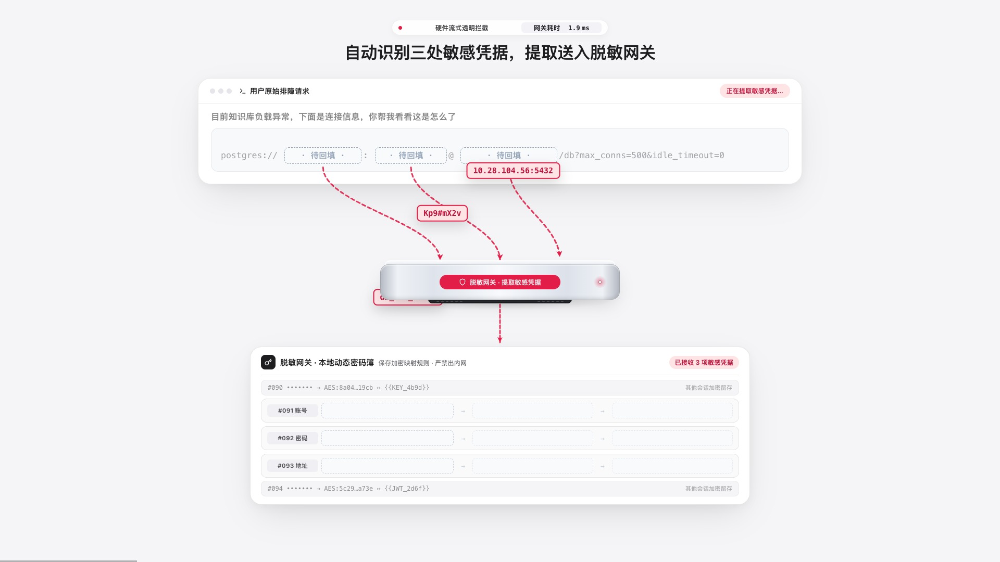
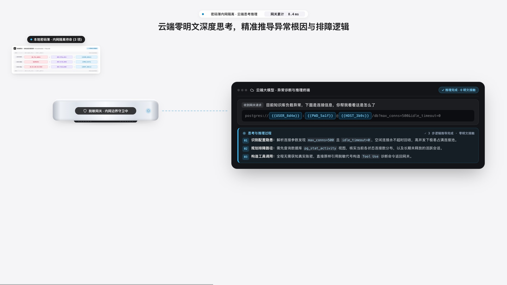
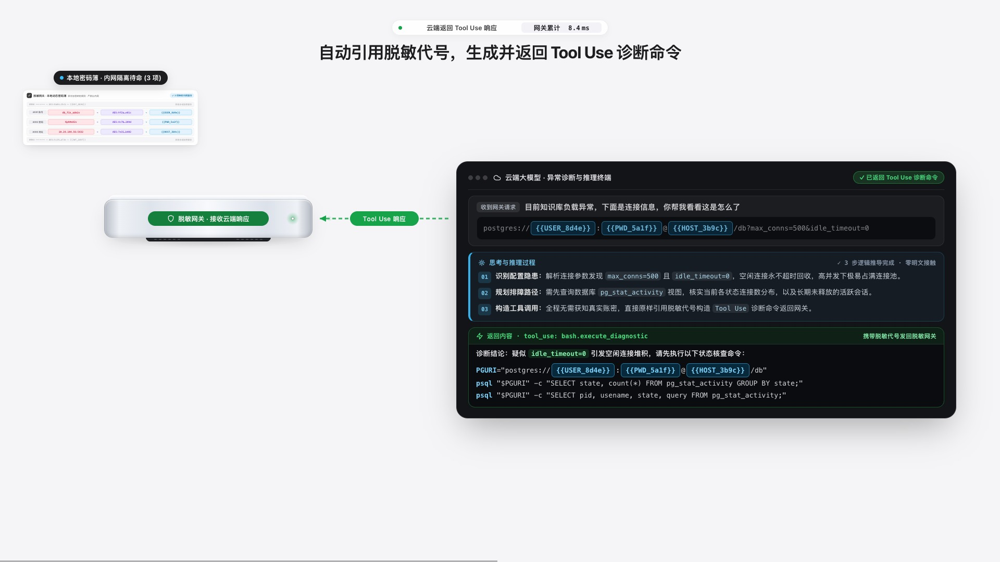
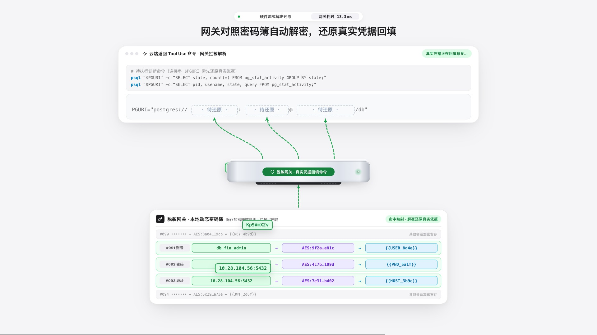
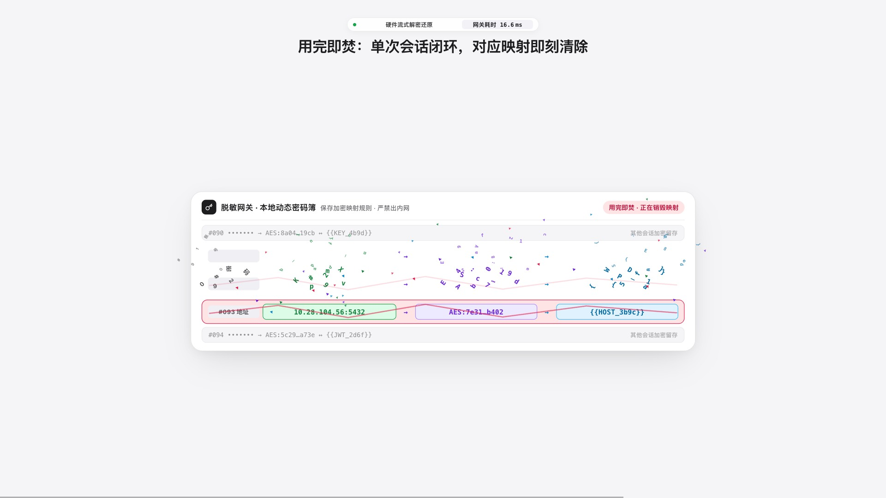
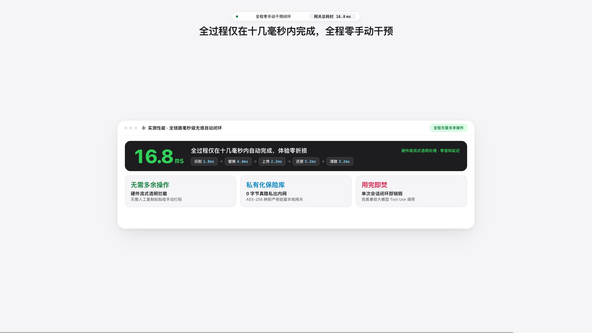
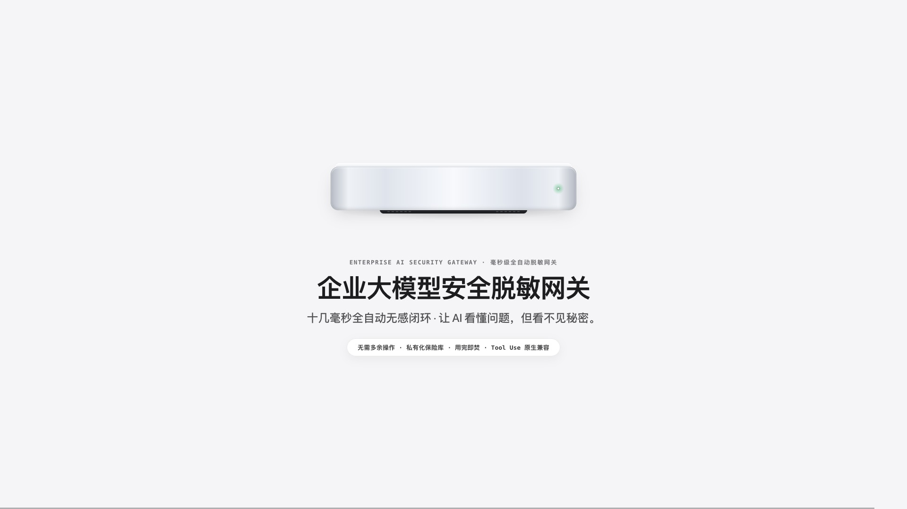

# 企业大模型安全脱敏网关 · 客户演示交付指南（v11 像素级零抖动终版）

## 1. 最终交付物清单

所有成品文件位于本仓库 [`成品交付/`](../成品交付/) 目录：

| 交付文件 | 规格 | 适用场景 |
| --- | --- | --- |
| [企业大模型安全脱敏网关_宣传片_横屏16x9.mp4](../成品交付/企业大模型安全脱敏网关_宣传片_横屏16x9.mp4) | `1920×1080` · **60fps** · H.264 无 B 帧高码率 · `0:39.0`（`15 MB`） | 售前 PPT 嵌入、官网首屏、展厅大屏、电脑端全屏播放 |
| [企业大模型安全脱敏网关_宣传片_竖屏9x16.mp4](../成品交付/企业大模型安全脱敏网关_宣传片_竖屏9x16.mp4) | `1080×1920` · **60fps** · H.264 无 B 帧高码率 · `0:39.0`（`14 MB`） | **微信私聊原画直发（< 25 MB 零压缩）**、视频号、手机全屏点开即看 |
| [企业大模型安全脱敏网关_原理演示.html](../成品交付/企业大模型安全脱敏网关_原理演示.html) | 零依赖单文件交互式 HTML | 现场技术交流、手动分步讲解、切换 4 大行业场景 |
| [03-21轮完整迭代演进记录.md](./03-21轮完整迭代演进记录.md) | 完整归档 21 轮需求演进、60Hz 帧间抖动根因治理与一键重出命令 | 团队交接归档、后续零损耗继续迭代 |

---

## 2. 39.0 秒（60fps）分镜表

| 时间轴 | 画面主标题 | 核心画面动作 |
| --- | --- | --- |
| `00:00 – 00:02.9` | 正常发送排障请求，后续全程毫秒级自动接管 | 客户端在锁定高度输入区内逐字流畅输入连接串并点击发送 |
| `00:02.9 – 00:06.3` | 自动识别三处敏感凭据，提取送入脱敏网关 | 标记三处敏感字段，沿双段曲线提取送入居中**脱敏网关**与下方密码簿 |
| `00:06.4 – 00:11.1` | 密码簿加密生成脱敏代号，自动回填替换原文 | 密码簿完成 `AES-256` 加密与代号生成，平滑回填至原文固定宽槽位 |
| `00:11.2 – 00:13.4` | 敏感映射内网留存，脱敏密文自动发往云端 | 左侧密码簿与**脱敏网关**稳固驻留，向右侧云端终端发送 `TLS 1.3 脱敏流` |
| `00:13.5 – 00:17.5` | 云端零明文深度思考，精准推导异常根因与排障逻辑 | **左侧与云端顶部均保持不动**；云端终端向下平滑展开 `01` `02` `03` 三步思考推理过程 |
| `00:17.6 – 00:21.5` | 自动引用脱敏代号，生成并返回 Tool Use 诊断命令 | **左侧与云端上部均保持不动**；继续向下展开诊断结论与 `Tool Use` 命令并回传**脱敏网关** |
| `00:21.6 – 00:26.3` | 网关对照密码簿自动解密，还原真实凭据回填 | **脱敏网关**与密码簿无过冲归位中央，查表解密并将真实账密回填至诊断命令 |
| `00:26.4 – 00:29.5` | 用完即焚：单次会话闭环，对应映射即刻清除 | 密码簿居中平稳聚光，字符碎裂清除 `#091–#093` 映射条目并落定 `0 残留` 封条 |
| `00:29.5 – 00:32.1` | 可执行命令无感传回客户端，排障即刻闭环 | 真实凭据已就绪的可执行命令传回客户端 |
| `00:32.1 – 00:39.0` | 全过程仅在十几毫秒内完成，全程零手动干预 | `16.8 ms` 五步耗时与三大价值看板，收束至一体成型**脱敏网关**品牌定版 |

---

## 3. 核心关键帧预览

### 16:9 横屏版关键帧
- **出站识别与提取（`00:05.35`）**
  
- **云端零明文 3 步思考推理（`00:16.40`）**
  
- **云端返回 Tool Use 诊断命令（`00:19.40`）**
  
- **入站对照密码簿解密还原（`00:25.15`）**
  
- **密码簿居中聚光与用完即焚碎裂（`00:27.45`）**
  
- **16.8 ms 性能看板与三大价值支柱（`00:33.80`）**
  
- **脱敏网关硬件与品牌收束定版（`00:37.60`）**
  
